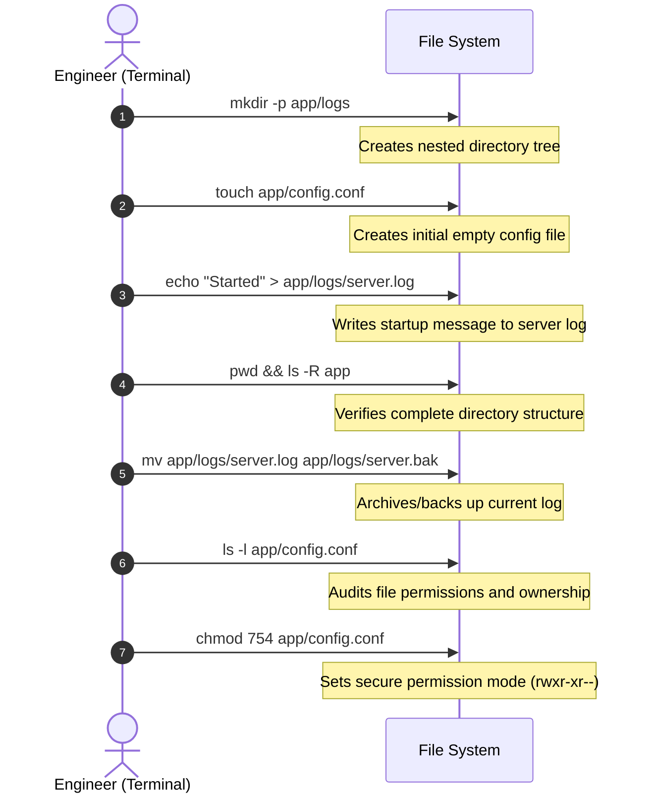

# 🐧 DecodeLabs Industrial Training Kit – DevOps Project 1
## Linux & Command Line Basics (Batch 2026)

[](https://decodelabs.in)
[](https://www.kernel.org)
[]()
[]()

---

## 📌 Table of Contents
1. [Executive Overview & Objectives](#1-executive-overview--objectives)
2. [Linux Filesystem Hierarchy (FHS)](#2-linux-filesystem-hierarchy-fhs)
3. [Essential Linux Commands Reference](#3-essential-linux-commands-reference)
4. [File Permissions & Ownership Deep Dive](#4-file-permissions--ownership-deep-dive)
5. [The "Danger Zone": Safe File Deletion & `rm -rf`](#5-the-danger-zone-safe-file-deletion--rm--rf)
6. [macOS vs Linux: Environment & Path Considerations](#6-macos-vs-linux-environment--path-considerations)
7. [Hands-On Implementation: The Mandatory Mission](#7-hands-on-implementation-the-mandatory-mission)
8. [Real-Time Log Monitoring with `tail -f`](#8-real-time-log-monitoring-with-tail--f)
9. [Web Application Directory Structure Design](#9-web-application-directory-structure-design)
10. [Submission Proof & Screenshot Checklist](#10-submission-proof--screenshot-checklist)
11. [Verification & Automation Scripts](#11-verification--automation-scripts)
12. [Conclusion & DevOps Competencies Gained](#12-conclusion--devops-competencies-gained)

---

## 1. Executive Overview & Objectives

In modern cloud computing, Site Reliability Engineering (SRE), and DevOps workflows, **over 90% of cloud workloads run on Linux** (AWS EC2, Google Cloud Compute, Azure VMs, Kubernetes worker nodes, and Docker containers). Mastering the Linux command line is the absolute foundational prerequisite for any DevOps engineer.

### 🎯 Key Learning Objectives
- **System Navigation & File Operations**: Confidently navigate arbitrary Linux directory trees, inspect file contents without GUI overhead, and perform surgical modifications.
- **Filesystem Hierarchy Standard (FHS)**: Understand the purpose of standard directories (`/bin`, `/etc`, `/var`, `/usr`, `/app`, etc.) to know exactly where configurations, binaries, and logs belong.
- **Security & Privilege Management**: Master Linux Discretionary Access Control (DAC)—`rwx` permission bits, octal calculation (e.g. `754`), and user/group ownership (`chown`).
- **Production Safety**: Understand catastrophic command hazards (such as `rm -rf /`), interactive confirmations (`rm -i`), and the Principle of Least Privilege.
- **Operational Observability**: Monitor live system events and streaming application logs using `tail -f`.
- **Mission Delivery**: Execute, verify, and document the DecodeLabs Mandatory Project 1 Mission for 100% compliance.

---

## 2. Linux Filesystem Hierarchy (FHS)

Unlike Windows, which uses drive letters (`C:\`, `D:\`), Unix/Linux uses a single unified hierarchical tree rooted at `/` (root directory). Every physical disk, partition, network share, or virtual filesystem is mounted somewhere beneath `/`.

```
/ (Root Directory)
├── bin/      -> Essential user command binaries (ls, cp, cat)
├── sbin/     -> System administrator binaries (fdisk, reboot, iptables)
├── boot/     -> Linux kernel bootloader files (vmlinuz, initrd)
├── dev/      -> Device nodes representing hardware & virtual devices (sda, null, zero)
├── etc/      -> System-wide configuration files (nginx.conf, sshd_config, passwd)
├── home/     -> User home directories (/home/alice, /home/ubuntu)
├── root/     -> Home directory for the root superuser
├── tmp/      -> Temporary scratch storage (cleared automatically on reboot)
├── usr/      -> User applications, shared libraries, and documentation
│   ├── bin/  -> Non-critical user binaries
│   └── lib/  -> Shared libraries
├── var/      -> Variable data that grows over time (logs, spool, caches)
│   └── log/  -> System and application log files
└── app/      -> Common convention for containerized or custom web application roots
```

### 📋 Standard Directory Breakdown

| Directory | Name / Full Form | Purpose & DevOps Relevance | Typical Example |
| :--- | :--- | :--- | :--- |
| `/` | **Root** | The base of the entire filesystem tree. Everything starts here. | `/` |
| `/bin` | **User Binaries** | Essential executable commands needed in single-user mode and by all users. | `/bin/ls`, `/bin/cat`, `/bin/bash` |
| `/sbin` | **System Binaries** | Critical binaries used by system administrators for maintenance and boot. | `/sbin/reboot`, `/sbin/iptables` |
| `/boot` | **Bootloader Files** | Kernel images, initial RAM disk (`initrd`), and GRUB bootloader configurations. | `/boot/vmlinuz-6.8.0-generic` |
| `/dev` | **Devices** | Special device nodes representing physical and pseudo-devices managed by `udev`. | `/dev/sda1` (disk), `/dev/null` (bitbucket) |
| `/etc` | **Editable Text Configs** | System-wide configuration files. Zero executable binaries belong here. | `/etc/nginx/nginx.conf`, `/etc/hosts` |
| `/home` | **User Homes** | Personal storage for regular users (`/home/<username>`). | `/home/ubuntu/.ssh/authorized_keys` |
| `/root` | **Root Home** | The home directory of the root superuser (separated from `/home` in case `/home` fails to mount). | `/root/.bashrc` |
| `/tmp` | **Temporary Files** | World-writable temporary scratch files. Usually wiped upon reboot or via systemd-tmpfiles. | `/tmp/build-cache.tar.gz` |
| `/usr` | **User System Resources**| Secondary hierarchy containing read-only user data, documentation, and tools. | `/usr/bin/git`, `/usr/lib/x86_64-linux-gnu` |
| `/var` | **Variable Data** | Files that change dynamically during operation: logs, databases, mail spools. | `/var/log/syslog`, `/var/log/nginx/` |
| `/app` | **Application Root** | Industry convention used in production servers and Docker containers for application code. | `/app/config.conf`, `/app/logs/` |

---

## 3. Essential Linux Commands Reference

Here is the operational reference for the commands required by this project:

```mermaid
graph TD
    A[Linux CLI Mastery] --> B[Navigation & Inspection]
    A --> C[File Management]
    A --> D[Content Viewing]
    A --> E[Permissions & Identity]
    A --> F[Monitoring & Observability]

    B --> B1[pwd: Print working directory]
    B --> B2[cd: Change directory]
    B --> B3[ls: List files -a, -l, -R]

    C --> C1[mkdir -p: Nested directory creation]
    C --> C2[touch: Create empty file / update timestamp]
    C --> C3[cp: Copy files & directories]
    C --> C4[mv: Move & rename files]
    C --> C5[rm / rm -i: Safe deletion]

    D --> D1[cat: Concatenate / dump file]
    D --> D2[less: Scrollable pager]
    D --> D3[head / tail: Start or end of file]
    D --> D4[echo: Output text / redirection]

    E --> E1[chmod: Modify permission bits 754]
    E --> E2[chown: Change user/group owner]
    E --> E3[whoami / id: User identity inspection]

    F --> F1[tail -f: Real-time streaming logs]
```



### 🛠️ Command Cheat Sheet

| Command | Syntax Example | What it Does in DevOps | Output / Verification Tip |
| :--- | :--- | :--- | :--- |
| `pwd` | `pwd` | **P**rint **W**orking **D**irectory. Shows absolute path of current location. | Always run after `cd` to verify target context. |
| `ls` | `ls` | Lists directory contents. | Shows plain names of files/dirs. |
| `ls -l` | `ls -l` | Long listing: shows permissions, link count, owner, group, size, modification timestamp. | Essential for auditing file security. |
| `ls -a` | `ls -a` | Shows all files including hidden dotfiles (`.env`, `.gitignore`, `.bashrc`). | Used to inspect hidden configs. |
| `ls -R` | `ls -R /app` | Recursive listing: lists subdirectories and their contents. | Verifies nested directory structures. |
| `cd` | `cd /var/log` | Change directory. `cd ~` goes to home; `cd ..` goes up one level; `cd -` toggles previous. | Updates terminal prompt path. |
| `mkdir` | `mkdir logs` | Makes a single directory (fails if parent does not exist). | Returns exit code 1 if parent missing. |
| `mkdir -p`| `mkdir -p /app/logs` | Makes all missing parent directories without throwing errors if they exist. | Standard in CI/CD automation scripts. |
| `touch` | `touch /app/config.conf`| Creates an empty file or updates the access/modification timestamp. | Instantly initializes placeholders. |
| `cat` | `cat file.txt` | Dumps the full content of a file to stdout. | Great for short files, configs, and scripts. |
| `less` | `less /var/log/syslog` | Terminal pager: interactively scroll up/down (`j`/`k`, `/search`, `q` to quit). | Best for large files without freezing terminal. |
| `head` | `head -n 5 file.log` | Displays the first N lines (default 10). | Inspects file headers or introductory lines. |
| `tail` | `tail -n 10 file.log` | Displays the last N lines (default 10). | Inspects most recent log entries. |
| `tail -f`| `tail -f /app/logs/server.log`| **Follows** file changes in real-time as new lines are appended. | Fundamental DevOps tool for debugging live services. |
| `echo` | `echo "Started" > server.log`| Prints text to stdout or redirects (`>` overwrites, `>>` appends). | Seeds configuration or log messages. |
| `cp` | `cp file.conf file.conf.bak` | Copies files. Use `cp -r` for recursive directory copies. | Creates backups prior to editing. |
| `mv` | `mv server.log server.bak` | Moves or renames files and directories. | Renaming files or archiving logs. |
| `rm` | `rm old.log` | Unlinks/deletes files. Permanent in Linux (no Recycle Bin). | Use carefully. |
| `rm -i` | `rm -i sensitive.conf`| Prompts interactively (`y`/`n`) before deleting each file. | Recommended safety flag for beginners. |
| `chmod` | `chmod 754 config.conf` | Changes read/write/execute permissions using octal or symbolic syntax. | Secures scripts and config files. |
| `chown` | `chown ubuntu:ubuntu /app` | Changes user and/or group ownership. Requires root/sudo. | Fixes web server or container file permissions. |
| `whoami`| `whoami` | Displays the effective username of the active shell session. | Confirms whether you are running as `root` or regular user. |
| `id` | `id` | Displays numerical UID, primary GID, and supplementary group memberships. | Critical for debugging permission issues. |

---

## 4. File Permissions & Ownership Deep Dive

Linux security is built upon Discretionary Access Control (DAC). Every file and directory is owned by a specific **User** and **Group**, and access is partitioned into three entity categories:

```
  -  r w x  r - x  r - -
  ┬  ─────  ─────  ─────
  │    │      │      │
  │    │      │      └─ Others permissions (World)
  │    │      └──────── Group permissions
  │    └─────────────── User (Owner) permissions
  └──────────────────── File Type (- = regular file, d = directory, l = symlink)
```

### 🔢 The Octal Permission Matrix

Permissions are represented by 3 bits per entity. Each bit corresponds to an octal value:

| Permission | Symbol | Binary Bit | Numeric Weight | Meaning for Files | Meaning for Directories |
| :--- | :---: | :---: | :---: | :--- | :--- |
| **Read** | `r` | `1 0 0` | **4** | Can view/read file contents | Can list contents with `ls` |
| **Write** | `w` | `0 1 0` | **2** | Can modify file contents | Can create or delete files inside |
| **Execute** | `x` | `0 0 1` | **1** | Can execute as program/script | Can enter directory (`cd` into it) |
| **No Access** | `-` | `0 0 0` | **0** | No permissions granted | No access |

### 🔍 Deep Dive: Decoding Permission `754` (`-rwxr-xr--`)

In the DecodeLabs project, we demonstrate permission `754` on our application configuration:

$$\begin{aligned}
\text{Owner (7)} &= 4 (\text{read}) + 2 (\text{write}) + 1 (\text{execute}) = \mathbf{rwx} \\
\text{Group (5)} &= 4 (\text{read}) + 0 (\text{no write}) + 1 (\text{execute}) = \mathbf{r-x} \\
\text{Others (4)} &= 4 (\text{read}) + 0 (\text{no write}) + 0 (\text{no execute}) = \mathbf{r--}
\end{aligned}$$

- **Owner**: Has full control (`rwx`). Can read, modify, and execute.
- **Group members**: Can read and execute/navigate (`r-x`), but cannot modify or tamper with the file.
- **Others (world)**: Read-only access (`r--`). Cannot write, cannot execute.

### 🛡️ Why `chown` Requires Administrator Privileges (`sudo`)

The `chown` command (Change Owner) changes who owns a file:
```bash
sudo chown -R www-data:www-data /app
```
**Why can't regular users give away their files?**
1. **Quota Tampering**: A user could create a 50GB file and change ownership to another user to exhaust their disk quota.
2. **Security & Impersonation**: A non-root user transferring ownership of a malicious setuid binary could compromise system integrity.
3. Therefore, POSIX systems strictly enforce that **only the root superuser (UID 0)** can reassign file ownership.

---

## 5. The "Danger Zone": Safe File Deletion & `rm -rf`

In Linux, there is **no desktop Recycle Bin or Trash folder** at the filesystem API level. When a file is unlinked via `rm`, its inode pointer is removed and its disk blocks become eligible for overwrite immediately.

### ⚠️ Why `rm -rf` is Dangerous

- `rm`: Remove file.
- `-r` (recursive): Traverses all subdirectories and sub-files without stopping.
- `-f` (force): Ignores non-existent files, bypasses write-protected confirmation prompts, and silences errors.

#### 💀 The Infamous "Space Typo" Disaster
Consider what happens when a developer attempts to clean a temporary folder:
```bash
# What the developer intended:
rm -rf /tmp/my-temp-dir

# The accidental space typo:
rm -rf / tmp/my-temp-dir
```
Because of the rogue space between `/` and `tmp`, the shell interprets this as **two separate arguments**:
1. `rm -rf /` -> Recursively and forcefully delete every file starting from the root of the operating system!
2. `rm -rf tmp/my-temp-dir` -> Already too late—system libraries, kernels, and configurations are gone.

### 🛡️ DevOps Best Practices for Safe Deletion

1. **Always use interactive mode (`rm -i`)** when deleting unfamiliar or sensitive files:
   ```bash
   rm -i /app/config.conf
   # Terminal prompts: remove regular file '/app/config.conf'? [y/n]
   ```
2. **Inspect with `ls` before deleting with `rm`**:
   ```bash
   # Step 1: Verify the wildcard target match
   ls -d /app/logs/*.old
   # Step 2: Once confirmed, delete
   rm /app/logs/*.old
   ```
3. **Never run `rm -rf /` or `rm -rf *` from an unverified directory**:
   Always run `pwd` before running recursive deletion commands.
4. **Use `trash-cli` on workstations**:
   Command-line utility that moves files to the freedesktop standard trash instead of permanent unlinking.

---

## 6. macOS vs Linux: Environment & Path Considerations

If you are following this guide on a **MacBook (macOS)**, there are critical architectural differences you must know:

### 1. Root Directory `/app` on macOS
- Starting with macOS 10.15 (Catalina) and continued through macOS Sequoia/Sonoma, Apple uses a **Read-Only Root System Volume (APFS Signed System Volume)** backed by System Integrity Protection (SIP).
- Running `sudo mkdir /app` on modern macOS will fail with:
  ```
  mkdir: /app: Read-only file system
  ```
- **The DevOps Solution**:
  - **Option 1 (Recommended for Local Practice)**: Use a project directory inside your user workspace, such as `$(pwd)/app` or `~/devops-project1/app`. All POSIX commands (`mkdir -p`, `touch`, `echo`, `ls -R`, `mv`, `chmod`, `tail -f`) work 100% identically!
  - **Option 2 (Docker / Ubuntu Container)**: Spin up an Ubuntu container where `/app` is native and unconstrained:
    ```bash
    docker run -it --rm -v $(pwd):/workspace ubuntu:24.04 bash
    ```

### 2. BSD Tools vs GNU Tools
- macOS defaults to BSD versions of CLI utilities (`ls`, `stat`, `sed`), whereas Linux distributions (Ubuntu, RHEL) use GNU Coreutils.
- Basic commands like `mkdir -p`, `touch`, `cat`, `mv`, `chmod`, `tail -f` are POSIX-standardized and work identically on both.

---

## 7. Hands-On Implementation: The Mandatory Mission

Here is the exact step-by-step workflow required by DecodeLabs. You can execute these commands directly in your terminal.



### Step 1: Create the Directory Structure
Create the application directory along with its nested `logs` subdirectory using `mkdir -p`:

```bash
mkdir -p app/logs
```
* **Explanation**: The `-p` (parents) flag creates parent directories if they don't already exist and produces no error if the directory already exists.
* **Verification**:
  ```bash
  ls -ld app/logs
  ```
  *Expected Output:*
  ```text
  drwxr-xr-x  2 farhan  staff  64 Oct 24 00:36 app/logs
  ```

---

### Step 2: Create the Application Configuration File
Initialize the configuration file using `touch`:

```bash
touch app/config.conf
```
* **Explanation**: `touch` creates an empty file if it does not exist, or updates its access/modification timestamps if it does.
* **Add Configuration Content**:
  ```bash
  cat << 'EOF' > app/config.conf
  PORT=8080
  HOST=0.0.0.0
  APP_NAME=DecodeLabs-DevOps-App
  ENVIRONMENT=production
  LOG_LEVEL=info
  LOG_DIR=/app/logs
  EOF
  ```
* **Verification**:
  ```bash
  cat app/config.conf
  ```

---

### Step 3: Write "Started" into the Server Log
Use `echo` with output redirection `>` to write the initial startup log entry:

```bash
echo "Started" > app/logs/server.log
```
* **Explanation**: The `>` operator redirects the output of `echo` to `server.log`, creating the file or overwriting any previous content.
* **Verification**:
  ```bash
  cat app/logs/server.log
  ```
  *Expected Output:*
  ```text
  Started
  ```

---

### Step 4: Verify Working Directory and Application Structure
Print the current working directory and inspect the recursive folder layout:

```bash
pwd
ls -R app
```
* **Explanation**:
  - `pwd` confirms your exact working directory path.
  - `ls -R` recursively traverses and lists all files within `app` and its subdirectories.
* **Expected Output**:
  ```text
  /Users/farhan/Codes/ritisha proc/project1

  app:
  config.conf  logs

  app/logs:
  server.log
  ```

---

### Step 5: Back Up the Log File
Rename/archive the active log file using `mv`:

```bash
mv app/logs/server.log app/logs/server.bak
```
* **Explanation**: `mv` moves or renames files. Here, it atomically renames `server.log` to `server.bak`, preserving the file contents and timestamps while freeing up the active filename for new logging.
* **Verification**:
  ```bash
  ls -l app/logs
  cat app/logs/server.bak
  ```
  *Expected Output:*
  ```text
  total 8
  -rw-r--r--  1 farhan  staff  8 Oct 24 00:36 server.bak

  Started
  ```

---

### Step 6: Audit the Configuration File
Perform a detailed permission and ownership audit using `ls -l`:

```bash
ls -l app/config.conf
```
* **Explanation**: `ls -l` outputs file type, permission bits, hard link count, owner, group, size in bytes, modification date/time, and filename.
* **Expected Output**:
  ```text
  -rw-r--r--  1 farhan  staff  122 Oct 24 00:36 app/config.conf
  ```

---

### Step 7: Apply Secure Permissions (`chmod 754`)
Apply the octal permission `754` (`rwxr-xr--`) to the configuration file:

```bash
chmod 754 app/config.conf
ls -l app/config.conf
```
* **Explanation**: Sets owner to Read/Write/Execute (`7`), group to Read/Execute (`5`), and others to Read-only (`4`).
* **Expected Output**:
  ```text
  -rwxr-xr--  1 farhan  staff  122 Oct 24 00:36 app/config.conf
  ```

---

## 8. Real-Time Log Monitoring with `tail -f`

In production, DevOps engineers constantly monitor log streams to observe live transactions, detect crashes, or follow system boot sequences.

### 🏃 Interactive Exercise:

1. **Terminal Tab 1 (Monitor)**:
   Run the following command to follow live log changes:
   ```bash
   tail -f app/logs/server.log
   ```

2. **Terminal Tab 2 (Log Generator)**:
   In a separate terminal window or background process, run the provided simulator:
   ```bash
   ./scripts/simulate_logs.sh
   ```

3. **Observed Behavior**:
   As `simulate_logs.sh` appends new requests every 2 seconds, Terminal Tab 1 instantly prints new entries onto your screen:
   ```text
   [2026-10-24 00:37:05] [INFO] [req-1] IP=192.168.1.14 GET /api/v1/health -> 200 OK in 42ms
   [2026-10-24 00:37:07] [INFO] [req-2] IP=192.168.1.29 GET /api/v1/login -> 200 OK in 68ms
   [2026-10-24 00:37:09] [WARN] [req-3] IP=192.168.1.41 GET /api/v1/payments -> 404 Not Found in 19ms
   ```
   *Press `Ctrl + C` to stop monitoring.*

---

## 9. Web Application Directory Structure Design

A production-grade Linux web application follows a standardized layout that separates source code, configurations, runtime data, logs, and static assets:

```
/app (or project root)
├── bin/                 # Operational scripts (start.sh, stop.sh, healthcheck.sh)
│   ├── start.sh
│   └── healthcheck.sh
├── config/              # Environment configurations
│   ├── app.conf
│   └── database.conf
├── logs/                # Application logs (server.log, access.log, error.log)
│   ├── server.bak
│   └── server.log
├── static/              # Static frontend assets (css, js, images)
│   ├── css/
│   └── js/
├── src/                 # Application source code
│   └── app.py / index.js
├── temp/                # Ephemeral scratch space
├── config.conf          # Main entrypoint configuration
└── README.md            # Documentation
```

### 🧱 Script to Generate Full Production Skeleton:
```bash
mkdir -p app/{bin,config,logs,static/{css,js},src,temp}
touch app/bin/start.sh app/config/app.conf app/src/index.js
chmod +x app/bin/start.sh
tree app/ || ls -R app/
```

---

## 10. Submission Proof & Screenshot Checklist

When submitting this project to the DecodeLabs evaluation portal, capture terminal screenshots as concrete evidence of your practical execution.

| Screenshot # | Name / ID | Command to Run | What it Proves to the Evaluator |
| :---: | :--- | :--- | :--- |
| 📸 **SS-01** | `user_identity.png` | `whoami && id` | Confirms current user context and privilege levels. |
| 📸 **SS-02** | `mkdir_and_touch.png` | `mkdir -p app/logs && touch app/config.conf` | Proves mastery of directory & file creation. |
| 📸 **SS-03** | `echo_and_log.png` | `echo "Started" > app/logs/server.log && cat app/logs/server.log` | Demonstrates file redirection and reading with `cat`. |
| 📸 **SS-04** | `pwd_and_tree.png` | `pwd && ls -R app` | Proves recursive directory tree and working directory validation. |
| 📸 **SS-05** | `mv_backup.png` | `mv app/logs/server.log app/logs/server.bak && ls -l app/logs` | Demonstrates log rotation and file renaming with `mv`. |
| 📸 **SS-06** | `chmod_audit.png` | `chmod 754 app/config.conf && ls -l app/config.conf` | Proves permission configuration (`-rwxr-xr--`). |
| 📸 **SS-07** | `tail_monitoring.png`| `tail -f app/logs/server.log` (with live logs flowing) | Proves real-time log observation skills. |
| 📸 **SS-08** | `full_verification.png`| `./scripts/verify_submission.sh` | Clean execution showing **100% PASS** on all automated test checks. |

---

## 11. Verification & Automation Scripts

This repository includes production-grade scripts to automate the workflow, test compliance, and serve the application:

### 1. Start the Live Application Server (`scripts/start_server.sh`)
Launches the background HTTP application server listening on `http://localhost:8080`:
```bash
./scripts/start_server.sh
```
* Dashboard URL: `http://localhost:8080`
* Health Endpoint: `http://localhost:8080/api/v1/health`
* Live Log File: `app/logs/server.log`

### 2. Stop the Application Server (`scripts/stop_server.sh`)
Gracefully terminates the background server process:
```bash
./scripts/stop_server.sh
```

### 3. Mission Runner (`scripts/run_mission.sh`)
Executes all mission steps in strict sequence with color-coded logging and automated output verification:
```bash
./scripts/run_mission.sh
```

### 4. Submission Audit (`scripts/verify_submission.sh`)
Runs a rigorous compliance check across all required files, permissions, and deliverables:
```bash
./scripts/verify_submission.sh
```

*Expected Verification Output:*
```text
==============================================================================
  DECODELABS DEVOPS PROJECT 1 - SUBMISSION AUDIT REPORT
==============================================================================

1. Mandatory Mission Checklist Verification:
  [PASS] Directory 'app/logs' exists
  [PASS] Configuration file 'app/config.conf' exists
  [PASS] Backup log file 'app/logs/server.bak' exists
  [PASS] server.bak contains 'Started'
  [PASS] config.conf has valid file permissions (754 or 644)

2. Project Deliverables Verification:
  [PASS] Professional README.md exists and is populated (>1KB)
  [PASS] Formal PROJECT_REPORT.md exists and is populated (>1KB)
  [PASS] Automation script 'scripts/run_mission.sh' is executable
  [PASS] Log simulator script 'scripts/simulate_logs.sh' is executable

✔ PERFECT SCORE: 9/9 checks passed. 100% submission ready!
```

---

## 12. Conclusion & DevOps Competencies Gained

Through the completion of **DecodeLabs DevOps Project 1: Linux & Command Line Basics**, the following core competencies were successfully developed and demonstrated:

1. **Foundational Command-Line Fluency**: Gained muscle memory and deep understanding of essential POSIX commands (`pwd`, `ls`, `cd`, `mkdir -p`, `touch`, `cat`, `less`, `head`, `tail`, `cp`, `mv`, `rm`, `echo`).
2. **System Architecture Awareness**: Mastered the Linux Filesystem Hierarchy (`/`, `/bin`, `/etc`, `/var`, `/tmp`, `/app`), understanding where configs, logs, and binaries reside in production.
3. **Security Engineering**: Understood Discretionary Access Control (DAC), calculated octal permissions (`754`), applied permissions via `chmod`, and analyzed ownership restrictions (`chown`).
4. **Operational Reliability & Safety**: Practiced safe deletion methodologies (`rm -i`), mitigating destructive errors like `rm -rf /`.
5. **Real-Time Observability**: Monitored live log streams with `tail -f`, mirroring day-to-day operations in production cloud environments.

This foundation prepares you for **Project 2: Linux Shell Scripting & Automation** in the DecodeLabs DevOps training track!
